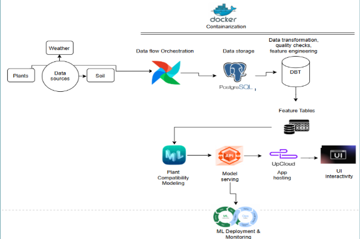
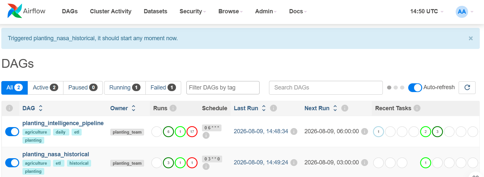
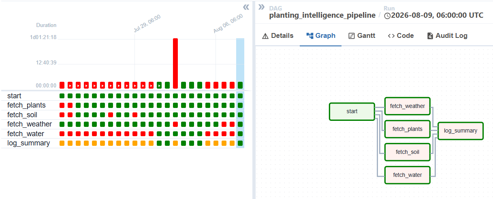
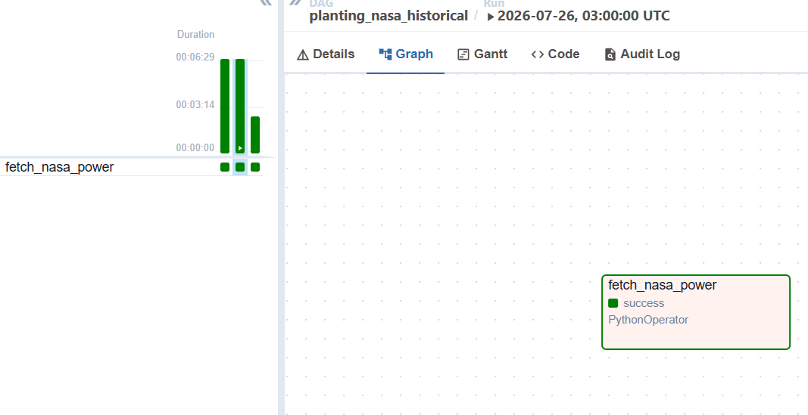
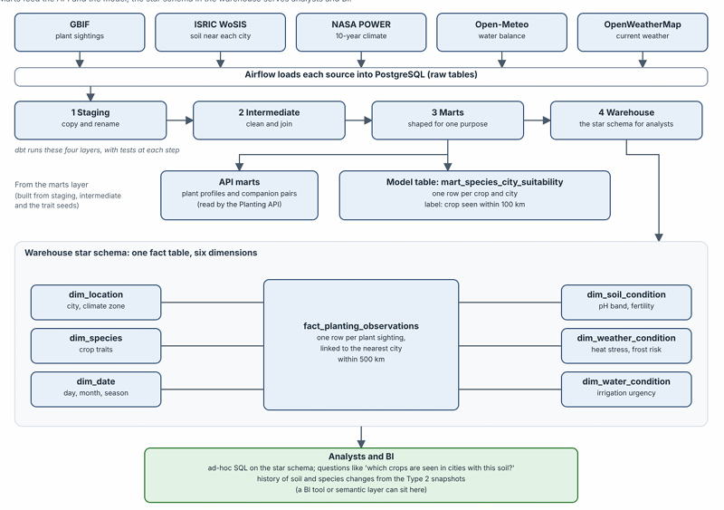
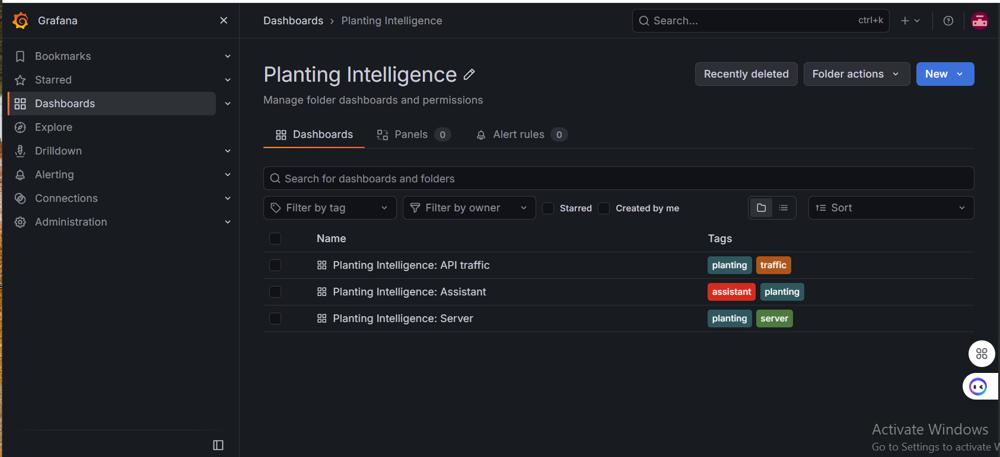
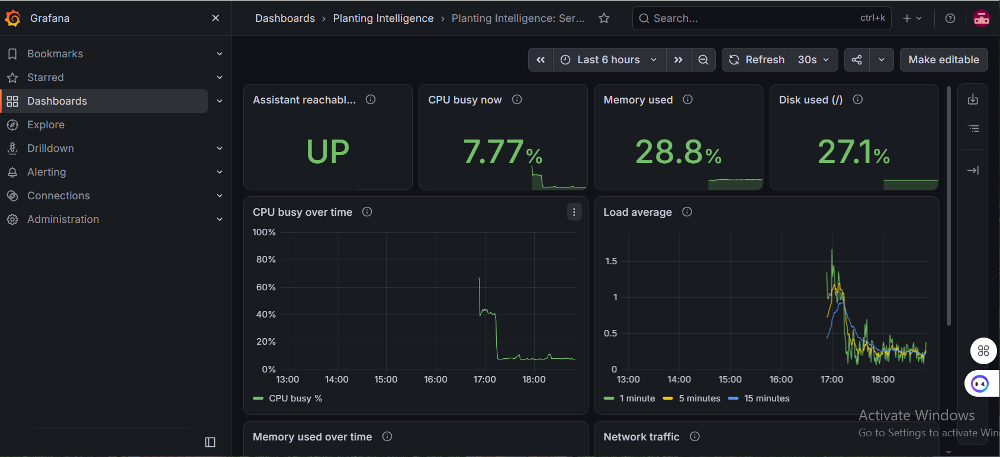
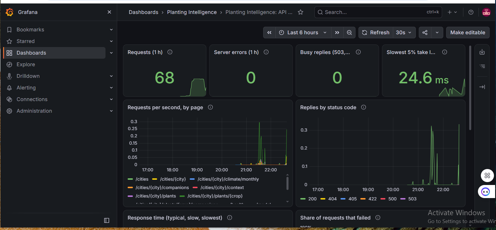
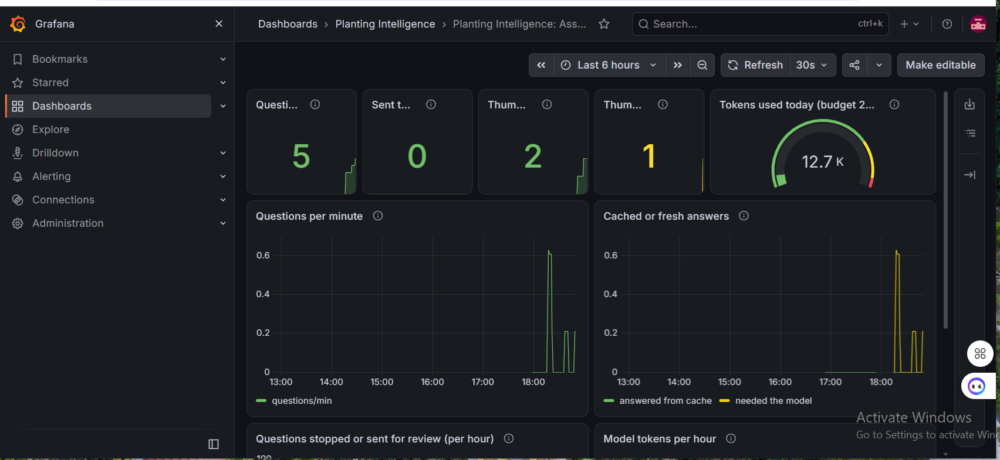

# RELATE | Relational Planting Technologies

## Values & Governance

This project operates from a place that couples localised market trade with human and ecological stewardship:

* **[VALUES_AND_GOVERNANCE](./docs/values_and_governance.md)** — Our shared understanding of financial risk, data sovereignty, and designing for human-scale context over extractive scale.

## Business Plan

* **[BUSINESS PLAN](./docs/business_plan.md)** 

## Agricultural Planting Intelligence Platform

### Problem Statement
Every second, the world loses roughly four football fields of healthy soil. By 2050, an estimated 95% of Earth's land could be degraded (Save Soil / UNEP, 2024). The primary driver is decades of intensive monoculture farming which had involved the same crop, on the same land, season after season, stripping the soil of the organic matter and biological diversity that keep it productive.
### Methodology

A Data & AI intelligence pipeline that focuses on relational planting to help farmers with paired-planting choices for soil preservation. It collects plant, soil, weather, and water data from public APIs, orchestrated by Apache Airflow and stores data in a dockerized postgres database environment. The solution integrates data engineering, analytics, feature engineering, ML/AI infrastructures, delivered through a backend feature and a user-friendly frontend interface.

  
   
   <b>SYSTEM DESIGN</b>

   
   

  
   
   <b>Airflow Orchestration</b>

   
   

  
   
   <b>Data Pipeline</b>

   
   

  
   
   <b>Nasa Data Ingestion</b>

   
   

### Data Model

The model serves three kinds of readers from one lineage: 
1.  a REST API that needs fast and simple lookups such as plant profiles and companion crops,
2.  a machine-learning job that needs one flat, labelled table with a crop-by-city grain,
3.  and analysts who need a clean star schema for routine data querying and planting intelligence

  
   
   <b>Model Design</b>

 
The ingestion phase pulls from 5 public sources for information on plants, soil, water, and weather. NASA climate data covers a city's dominant climatic conditions over a 10-year period. This phase also collects information about the time of ingestion so any downstream
row can be traced to the load that produced it. The model also incorporates the Type 2 snapshots, which add history tracking how a city's soil values changed over time.
Two Airflow DAGs handle data loading, separated by how frequently the underlying data changes:

1. **Planting Intelligence Pipeline:** Runs daily at 06:00. It fetches plant, soil, weather, and water data in parallel, then logs a summary. Each task retries twice, with a five-minute delay between attempts. Catchup is disabled to prevent a restart from triggering a flood of historical runs.

2. **NASA Climate History Pipeline:** Runs every Sunday at 03:00. It refreshes ten years of NASA POWER climate history, with a two-hour execution timeout. Since historical climate data changes slowly, weekly updates are sufficient. This also ensures that the model retraining scheduled for 09:00 on Sundays uses a refreshed climate dataset that has completed several hours earlier.
The warehouse is a classic STAR schema with one fact table and six dimensions. The fact table has a grain of one row per plant, while the dimension tables define entities like locations, plant species, dates, soil condition, water condition, and weather condition. 
The data mart which supports machine learning consists of 4 tables covering dominant annual features, seasonal features, planting features, and city suitability. It also supports the API with plant profiles as well as city companions derived from the haversine distance, which ranks cities per plant occurrence and keeps the nearest plant within 500 kilometers.
The model makes use of a defensive approach via more than 80 generic tests across staging, intermediate, marts, warehouse, and seeds, and ensures that a failing test stops the build before bad data reaches the marts. The weekly model retrain begins with its own data
health check for the right amount of cities, crops, no duplicates, and a fingerprint check that skips the run if nothing changed.

   
   

  
   
   <b>GRAFANA DASHBOARD MONITORING</b>

   
   

  
   
   <b>GRAFANA SERVER MONITORING</b>

   
   

  
   
   <b>GRAFANA API REQUEST MONITORING</b>

   
   

  
   
   <b>GRAFANA AI & HUMAN IN THE LOOP MONITORING</b>

   
   
